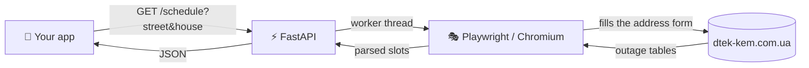

<div align="center">

# ⚡ DTEK Kyiv Shutdowns

**A tiny HTTP API that returns the planned power-outage schedule for any Kyiv address.**

Scrapes the official [DTEK-KEM outage page](https://www.dtek-kem.com.ua/ua/shutdowns) with a headless Chromium and returns the hourly schedule as clean JSON.

[🇺🇦 Українська](README.uk.md) · 🇬🇧 **English**


</div>

---

## ✨ Features

- 🔎 **Address lookup** by street and house number, exactly as on the official site
- 🕐 **24 hourly slots** per day, with a status for each hour
- 📅 **Smart day selection** for Europe/Kyiv: today and tomorrow, skipping days with no outages
- 🧭 **Resilient selectors**: handles overlays, and forms that live in the main DOM or an iframe
- 🐳 **One command** to run in Docker, with a health check
- ⚙️ **No hardcoded site values**: URL, timezone, locale and timeouts are all configurable

---

## 🧭 How it works



Each hour is mapped to a status:

| Status | Meaning |
|---|---|
| `off_full_hour` | 🔴 Power off for the full hour |
| `off_first_30` | 🟠 Power off for the first 30 minutes |
| `off_second_30` | 🟠 Power off for the second 30 minutes |
| `light_on` | 🟢 Power on |
| `unknown` | ⚪ Cell class not recognized (site changed?) |

---

## 🚀 Quick start

### With Docker (recommended)

```bash
git clone https://github.com/tmykhalc/dtek-kyiv-shutdowns.git
cd dtek-kyiv-shutdowns
cp .env.example .env          # optional, every value has a default
docker compose up -d --build
curl http://localhost:8081/health
```

### Locally

```bash
python -m venv .venv && source .venv/bin/activate
pip install -r requirements.txt
playwright install --with-deps chromium
uvicorn service:app --port 8081
```

Interactive API docs: **http://localhost:8081/docs**

---

## 🏠 Choosing the street

The site suggests streets as you type, and the service picks the **first** suggestion. So the more specific your input, the fewer suggestions appear and the more likely you get the street you meant.

| You type | Suggestions shown | Verdict |
|---|---|---|
| `Перемоги` | 2 (`вул. перемоги`, `сел. перемоги`) | ⚠️ ambiguous |
| `вул. Перемоги` | 1 | ✅ exact |
| `Центральна` | 3 (different districts) | ⚠️ ambiguous |
| `вул. Центральна (осокорки)` | 1 | ✅ exact |
| `вул. Соборна, с. петр. борщаг` | 1 | ✅ exact |
| `Перемоги 1` | 0 | ❌ house number does not belong in `street` |

> 💡 **Tips**
> - Start with the `вул.` prefix, exactly as the site writes it. It narrowed `Перемоги` from 2 suggestions to 1, but did not resolve `Центральна` or `Соборна`.
> - If the list shows a district or village in brackets, include it: `вул. Центральна (осокорки)`.
> - Put the number in `house`, never in `street`.

---

## 📡 API

### `GET /schedule`

```bash
curl -G "http://localhost:8081/schedule" \
  --data-urlencode "street=вул. Перемоги" \
  --data-urlencode "house=1"
```

### `POST /schedule`

```bash
curl -X POST http://localhost:8081/schedule \
  -H "Content-Type: application/json" \
  -d '{"street": "вул. Перемоги", "house": "1", "headless": true, "debug": false}'
```

| Parameter | Type | Default | Description |
|---|---|---|---|
| `street` | string | — | Street as the site suggests it, e.g. `вул. Перемоги` |
| `house` | string | — | House number, e.g. `1` |
| `headless` | bool | `true` | Run Chromium without a window |
| `debug` | bool | `false` | Extra diagnostics in the logs |

<details>
<summary><b>📦 Response shape</b></summary>

```jsonc
{
  "source": "https://www.dtek-kem.com.ua/ua/shutdowns",
  "queried_at": "2026-10-12T15:33:02+00:00",
  "street_input": "вул. Перемоги",
  "house_input": "1",
  "last_update_local": "2026-10-12T15:36:00",
  "multiple_feeders": true,
  "site_message": "…",               // text shown by the site, or null
  "emergency": {                     // read from the "Шановні клієнти!" modal
    "active": true,                  // notice mentions emergency shutdowns (екстрені відключення)
    "applies": false,                // active AND names DTEK_DISTRICT (always = active if unset)
    "district_filter": "голосіїв",
    "text": "…"
  },
  "raw_by_timestamp": { "1791752400": [ { "hour": 0, "status": "light_on" }, "…" ] },
  "by_date": { "2026-10-12": [ "…24 slots…" ] },
  "selected_days": ["2026-10-12"],   // days with at least one outage
  "selected_by_date": { "2026-10-12": [ "…24 slots…" ] }
}
```

</details>

Errors come back as `500` with the reason in `detail`.

---

## ⚙️ Configuration

Every site-facing value can be set with an environment variable. Unset variables use the default.

| Variable | Default | What it controls |
|---|---|---|
| `DTEK_URL` | `https://www.dtek-kem.com.ua/ua/shutdowns` | Page to scrape |
| `DTEK_TIMEZONE` | `Europe/Kyiv` | Timezone used to pick "today" and "tomorrow" |
| `DTEK_LOCALE` | `uk-UA` | Browser locale |
| `DTEK_USER_AGENT` | Chrome 122 on Windows | Browser user agent |
| `DTEK_NAV_TIMEOUT_MS` | `45000` | Page load timeout |
| `DTEK_ELEMENT_TIMEOUT_MS` | `8000` | Wait for form fields and suggestions |
| `DTEK_DISTRICT` | empty | Stem of your district as written in the site notice, e.g. `Голосіїв`. When set, `emergency.applies` is true only if the notice names it |
| `DTEK_LOG_LEVEL` | `INFO` | `DEBUG`, `INFO`, `WARNING`, `ERROR` |
| `HOST_PORT` | `8081` | Port published by Docker Compose |

---

## 🧱 Project layout

```
.
├── service.py                  # FastAPI app: /health, /schedule (GET and POST)
├── scrape_dtek_playwright.py   # Playwright scraper + CLI
├── Dockerfile                  # Playwright base image, runs uvicorn on $PORT (8081)
├── docker-compose.yml          # Service definition, health check, shared memory
├── requirements.txt
└── .env.example                # Documented configuration
```

### 🖥️ CLI

```bash
python scrape_dtek_playwright.py --street "вул. Перемоги" --house "1" --out result.json --debug
```

Add `--headful` to watch the browser.

---

## 🛠️ Troubleshooting

<details>
<summary><b>500 · <code>Locator.wait_for: Timeout</code> on the street field</b></summary>

The page is slow or the form changed. Raise `DTEK_NAV_TIMEOUT_MS`, run with `DTEK_LOG_LEVEL=DEBUG`, and check whether the site still shows the address form.
</details>

<details>
<summary><b>500 · <code>House input not found; selectors outdated.</code></b></summary>

The site renamed its form fields. Update the selector lists in `fill_address()`.
</details>

<details>
<summary><b>Wrong street is used</b></summary>

The service picks the first suggestion. Make the input more specific, as described in [Choosing the street](#-choosing-the-street).
</details>

<details>
<summary><b>Port 8080 is already in use</b></summary>

Set `HOST_PORT` to a free port in `.env`, for example `HOST_PORT=8090`.
</details>

---

## 🔐 Notes on scraping

- The site's markup is not an API. If DTEK changes its page, selectors in `scrape_dtek_playwright.py` are the parts to update.
- The site-specific values are kept in code on purpose: the consent-button texts, overlay selectors, the form and table selectors, and the `cell-*` class names that map to statuses.
- Please keep your polling reasonable. The service loads a full browser per request.

---

<div align="center">

Made with ☕ and 🔌 · Data belongs to [DTEK-KEM](https://www.dtek-kem.com.ua/)

</div>
