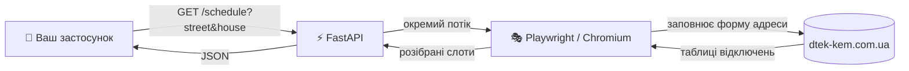

<div align="center">

# ⚡ DTEK Kyiv Shutdowns

**Невеликий HTTP API, який повертає графік планових відключень світла для будь-якої адреси в Києві.**

Збирає дані з офіційної [сторінки відключень ДТЕК-КЕМ](https://www.dtek-kem.com.ua/ua/shutdowns) через headless Chromium і віддає погодинний графік у зрозумілому JSON.

🇬🇧 [English](README.md) · 🇺🇦 **Українська**


</div>

---

## ✨ Можливості

- 🔎 **Пошук за адресою**: вулиця і номер будинку так, як їх показує сайт
- 🕐 **24 погодинні слоти** на день, із статусом для кожної години
- 📅 **Розумний вибір днів** за часовим поясом Europe/Kyiv: сьогодні і завтра, без днів без відключень
- 🧭 **Стійкі селектори**: працює з перекриттями сторінки і з формою, яка знаходиться в основному DOM або в iframe
- 🐳 **Одна команда** для запуску в Docker, з перевіркою стану
- ⚙️ **Без жорстко вбитих значень сайту**: URL, часовий пояс, локаль і таймаути налаштовуються

---

## 🧭 Як це працює



Кожна година отримує один із статусів:

| Статус | Значення |
|---|---|
| `off_full_hour` | 🔴 Світла немає протягом усієї години |
| `off_first_30` | 🟠 Світла немає перші 30 хвилин |
| `off_second_30` | 🟠 Світла немає другі 30 хвилин |
| `light_on` | 🟢 Світло є |
| `unknown` | ⚪ Клас комірки не розпізнано (можливо, сайт змінився) |

---

## 🚀 Швидкий старт

### Через Docker (рекомендовано)

```bash
git clone https://github.com/tmykhalc/dtek-kyiv-shutdowns.git
cd dtek-kyiv-shutdowns
cp .env.example .env          # необов'язково, кожне значення має типове
docker compose up -d --build
curl http://localhost:8081/health
```

### Локально

```bash
python -m venv .venv && source .venv/bin/activate
pip install -r requirements.txt
playwright install --with-deps chromium
uvicorn service:app --port 8081
```

Інтерактивна документація API: **http://localhost:8081/docs**

---

## 🏠 Як вибрати вулицю

Сайт пропонує вулиці під час введення, а сервіс бере **перший** варіант зі списку. Тому чим точніше ви вводите назву, тим менше варіантів з'являється і тим імовірніше ви отримаєте саме свою вулицю.

| Ви вводите | Варіантів у списку | Висновок |
|---|---|---|
| `Перемоги` | 2 (`вул. перемоги`, `сел. перемоги`) | ⚠️ неоднозначно |
| `вул. Перемоги` | 1 | ✅ точно |
| `Центральна` | 3 (різні райони) | ⚠️ неоднозначно |
| `вул. Центральна (осокорки)` | 1 | ✅ точно |
| `вул. Соборна, с. петр. борщаг` | 1 | ✅ точно |
| `Перемоги 1` | 0 | ❌ номер будинку не належить до `street` |

> 💡 **Поради**
> - Починайте з префікса `вул.`, так само, як його пише сайт.
> - Якщо у списку назва вулиці має район або село в дужках чи після коми, введіть її повністю: `вул. Центральна (осокорки)`.
> - Номер будинку передавайте в `house`, а не в `street`.

---

## 📡 API

### `GET /schedule`

```bash
curl -G "http://localhost:8081/schedule" \
  --data-urlencode "street=вул. Перемоги" \
  --data-urlencode "house=1"
```

### `POST /schedule`

```bash
curl -X POST http://localhost:8081/schedule \
  -H "Content-Type: application/json" \
  -d '{"street": "вул. Перемоги", "house": "1", "headless": true, "debug": false}'
```

| Параметр | Тип | Типово | Опис |
|---|---|---|---|
| `street` | рядок | — | Вулиця так, як її пропонує сайт, наприклад `вул. Перемоги` |
| `house` | рядок | — | Номер будинку, наприклад `1` |
| `headless` | bool | `true` | Запускати Chromium без вікна |
| `debug` | bool | `false` | Додаткова діагностика в логах |

<details>
<summary><b>📦 Структура відповіді</b></summary>

```jsonc
{
  "source": "https://www.dtek-kem.com.ua/ua/shutdowns",
  "queried_at": "2026-10-12T15:33:02+00:00",
  "street_input": "вул. Перемоги",
  "house_input": "1",
  "last_update_local": "2026-10-12T15:36:00",
  "multiple_feeders": true,
  "site_message": "…",               // текст, який показує сайт, або null
  "raw_by_timestamp": { "1791752400": [ { "hour": 0, "status": "light_on" }, "…" ] },
  "by_date": { "2026-10-12": [ "…24 слоти…" ] },
  "selected_days": ["2026-10-12"],   // дні, де є хоча б одне відключення
  "selected_by_date": { "2026-10-12": [ "…24 слоти…" ] }
}
```

</details>

Помилки повертаються зі статусом `500`, а причина є в полі `detail`.

---

## ⚙️ Налаштування

Кожне значення, яке стосується сайту, можна задати змінною середовища. Якщо змінну не задано, використовується типове значення.

| Змінна | Типово | Що керує |
|---|---|---|
| `DTEK_URL` | `https://www.dtek-kem.com.ua/ua/shutdowns` | Сторінка, з якої збираються дані |
| `DTEK_TIMEZONE` | `Europe/Kyiv` | Часовий пояс для визначення «сьогодні» і «завтра» |
| `DTEK_LOCALE` | `uk-UA` | Локаль браузера |
| `DTEK_USER_AGENT` | Chrome 122 на Windows | User agent браузера |
| `DTEK_NAV_TIMEOUT_MS` | `45000` | Таймаут завантаження сторінки |
| `DTEK_ELEMENT_TIMEOUT_MS` | `8000` | Очікування полів форми і підказок |
| `DTEK_LOG_LEVEL` | `INFO` | `DEBUG`, `INFO`, `WARNING`, `ERROR` |
| `HOST_PORT` | `8081` | Порт, який публікує Docker Compose |

---

## 🧱 Структура проєкту

```
.
├── service.py                  # застосунок FastAPI: /health, /schedule (GET і POST)
├── scrape_dtek_playwright.py   # скрейпер Playwright + CLI
├── Dockerfile                  # базовий образ Playwright, uvicorn на $PORT (8081)
├── docker-compose.yml          # опис сервісу, перевірка стану, спільна пам'ять
├── requirements.txt
└── .env.example                # задокументована конфігурація
```

### 🖥️ CLI

```bash
python scrape_dtek_playwright.py --street "вул. Перемоги" --house "1" --out result.json --debug
```

Додайте `--headful`, щоб бачити вікно браузера.

---

## 🛠️ Усунення несправностей

<details>
<summary><b>500 · <code>Locator.wait_for: Timeout</code> на полі вулиці</b></summary>

Сторінка повільна або форма змінилася. Збільште `DTEK_NAV_TIMEOUT_MS`, запустіть з `DTEK_LOG_LEVEL=DEBUG` і перевірте, чи сайт досі показує форму адреси.
</details>

<details>
<summary><b>500 · <code>House input not found; selectors outdated.</code></b></summary>

Сайт перейменував поля форми. Оновіть списки селекторів у `fill_address()`.
</details>

<details>
<summary><b>Використовується не та вулиця</b></summary>

Сервіс бере перший варіант зі списку. Зробіть введення точнішим, як описано в розділі [Як вибрати вулицю](#-як-вибрати-вулицю).
</details>

<details>
<summary><b>Порт 8080 уже зайнятий</b></summary>

Задайте `HOST_PORT` у `.env` на вільний порт, наприклад `HOST_PORT=8090`.
</details>

---

## 🔐 Примітки щодо збору даних

- Розмітка сайту не є API. Якщо ДТЕК змінить сторінку, оновлювати потрібно селектори в `scrape_dtek_playwright.py`.
- Значення, специфічні для сайту, навмисно залишено в коді: тексти кнопок згоди, селектори перекриттів, селектори форми й таблиць та класи `cell-*`, що відповідають статусам.
- Будь ласка, не надсилайте надто багато запитів. Сервіс запускає повний браузер на кожен запит.

---

<div align="center">

Зроблено з ☕ і 🔌 · Дані належать [ДТЕК-КЕМ](https://www.dtek-kem.com.ua/)

</div>
